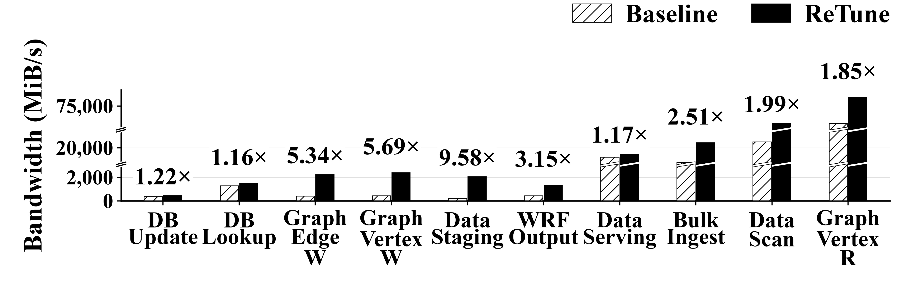
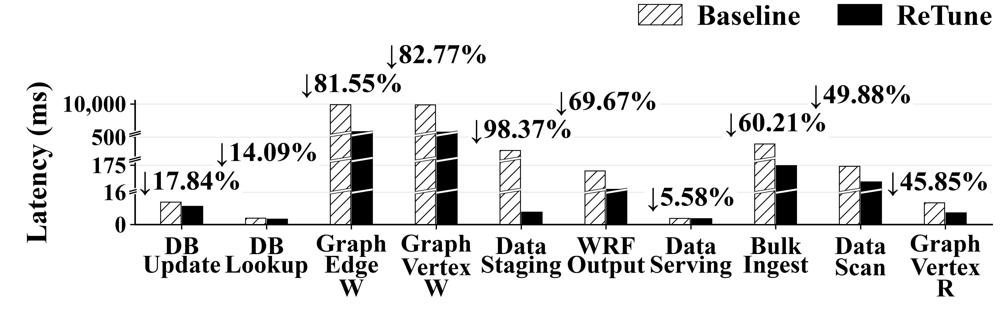
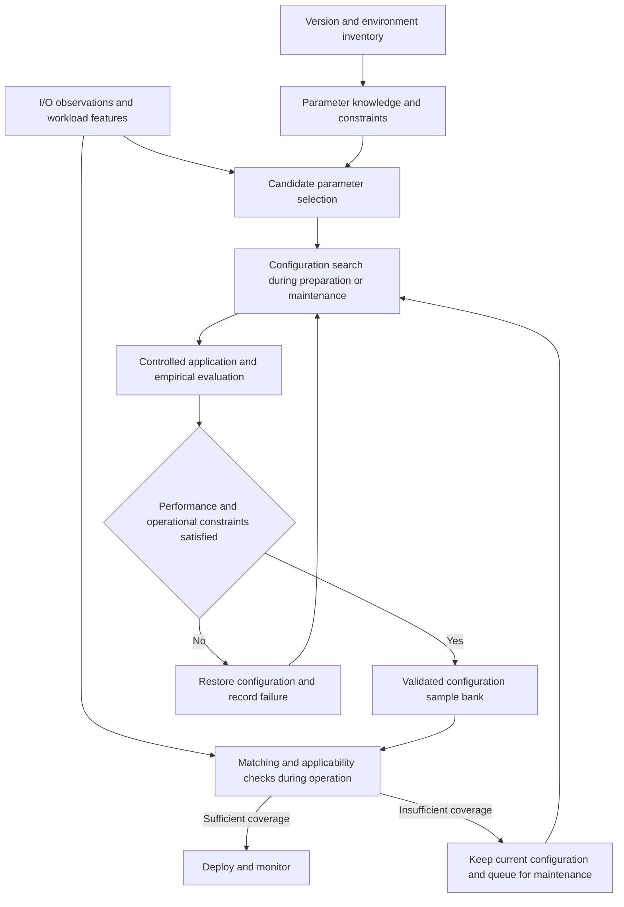

# Automated Tuning Methods and File-System Adaptation Guide

**English** | [简体中文](README.zh-CN.md)

This guide separates **file-system tuning** from **database tuning** by each work's original target. ReTune and STELLAR address file systems; ADSTS is included as related distributed-storage work. GPTuner, E2ETune, TopTune, Rabbit, λ-Tune, and AgentTune form a separate database group, with proposed file-system adaptations clearly identified.

> **Scope:** Descriptions of existing methods are based on papers, author-maintained repositories, or the supplied comparison table. Sections labeled “Suggested file-system adaptation” propose engineering changes; they do not imply that the original papers implemented those changes. This guide does not report comparative file-system experiments on these methods.
>
> Sources checked on 2026-11-03. Current repository capabilities may differ from the experimental settings in a paper. Pin the paper version, code commit, and model version when reproducing results.

## Contents

- [Method overview](#overview)
- [File-system tuning](#storage-methods)
- [ReTune: Guangzhou results](#guangzhou-results)
- [Database tuning: migration references](#database-methods)
- [Five modules for file-system adaptation](#adaptation)
- [Evaluation and comparison guidelines](#evaluation)
- [Original comparison tables and glossary](ORIGINAL_COMPARISON.md)

## Method overview

Classification follows the system being tuned, not whether a method uses an LLM, BO, or RL. Database tuning results are not presented as file-system results.

### File-system tuning

ReTune is this project; STELLAR targets parallel file systems. ADSTS is grouped here as related distributed-storage work, without claiming verified end-to-end CephFS results.

| Method | Original tuning target | Core mechanism | Main adaptation task | Resources |
| :--- | :--- | :--- | :--- | :--- |
| **ReTune** | File systems (this project) | Dual-LLM selection, Agent/CEM exploration, and matching against validated samples | Integrate the preparation, operation, and maintenance phases | [Project results in Guangzhou](#guangzhou-results); design from the supplied table and project draft |
| **STELLAR** | Parallel file systems (Lustre) | Parameter extraction, I/O analysis, agent-driven evaluation, and rule accumulation | Extend from Lustre to the target file system and its production constraints | [Paper](https://arxiv.org/abs/2602.23220) · [Code archive](https://zenodo.org/records/15284241) |
| **ADSTS** | Distributed storage (related work) | Supplied table: LASSO selection, RL exploration, and empirical feedback | Define file-system states, actions, and rewards | [Paper entry](https://doi.org/10.1145/3545008.3545012) |

### Database tuning

These six methods originally tune database systems. Their file-system adaptations below are engineering proposals rather than results reported by the original papers.

| Method | Original tuning target | Core mechanism | Main adaptation task | Resources |
| :--- | :--- | :--- | :--- | :--- |
| **GPTuner** | Database systems | Extract tuning knowledge, select knobs and ranges, then perform coarse-to-fine BO | Replace the knowledge base and evaluation runner | [Paper](https://arxiv.org/abs/2311.03157) · [Code](https://github.com/SolidLao/GPTuner) |
| **E2ETune** | Database systems | Generate training data offline and fine-tune a model to produce configurations directly | Rebuild I/O features, training examples, and the performance surrogate | [Paper](https://www.vldb.org/pvldb/vol18/p5540-huang.pdf) · [Code](https://github.com/RUCKBReasoning/E2ETune) |
| **TopTune** | Database systems | Collaboratively optimize separate categorical and continuous subspaces | Rebuild the mixed search space, constraints, and evaluation cost accounting | [Paper](https://ieeexplore.ieee.org/abstract/document/11113200/) |
| **Rabbit** | Database systems | Supplied table: RAG-assisted selection, LLM exploration, and GP plus empirical evaluation | Build versioned parameter knowledge and tuning histories | [Paper entry](https://doi.org/10.1109/ICDE65448.2025.00284) |
| **λ-Tune** | Database systems | Generate complete candidate configurations and control evaluation costs | Replace SQL context with I/O context and configuration plans | [Paper](https://arxiv.org/abs/2411.03500) · [Code](https://github.com/gsvic/lambda-tune) |
| **AgentTune** | Database systems | Four agents for workload analysis, knob selection, range pruning, and recommendation | Replace domain inputs and system tools for each agent | [Code and paper entry](https://github.com/intlyy/AgentTune) |

The descriptions of Rabbit and ADSTS provisionally follow the supplied table because their full papers were unavailable for verification during this review. A missing code link means that an official author repository was not confirmed, not that no public implementation exists. STELLAR provides an author-published code archive.

### Interpreting deployment and safety in the original table

- **LLM deployment:** Distinguish open model weights, the actual inference location, and the service used in the paper's experiments. An open-weight model can also be accessed through an external API.
- **Clone environment (CE):** Requiring empirical feedback, using a separate test cluster, and requiring a clone of production are different conditions.
- **Stress testing (ST):** It provides performance evidence for a candidate, but does not establish production safety by itself. Tail latency, failures, recovery, and durability semantics also need evaluation.
- **High / Medium / Low:** These labels are preserved in the [original tables](ORIGINAL_COMPARISON.md) as qualitative judgments from the supplied draft. They are not rankings obtained under a common experimental setup.

## File-system tuning

This group presents the project itself and work on file systems, followed by related distributed-storage research. ADSTS is not treated as evidence of a verified CephFS application-level tuning workflow.

### ReTune: separating search and validation from online recommendation

**Project design.** According to the supplied table and project design draft, ReTune uses two local LLMs for parameter selection and cross-verification. An agent invokes numerical search tools to build validated samples during preparation or maintenance; the operation phase recommends configurations based on workload similarity. Here, `Workload sim.` means **workload similarity**, not a simulator.

**Suggested file-system adaptation:**

| Phase | Required integration |
| :--- | :--- |
| Preparation | Build parameter knowledge for the target version, controlled configuration interfaces, and workload representations. Generate and validate the initial samples. |
| Operation | Filter samples by version, hardware, and configuration applicability before matching workloads. Propose a change only when the coverage threshold is satisfied. |
| Maintenance | Search and measure uncovered workloads within a budget. Add validated configurations to the sample bank and update invalidated records. |

**Applicability limits.** Retain the current configuration and register workloads for later processing when sample coverage is insufficient. Calibrate similarity against regression risk in the target environment; similarity alone is not a safety guarantee. Avoiding a production clone still leaves preparation, maintenance, and validation costs.

#### Guangzhou results: 128 physical storage nodes

The following **CephFS I/O tuning** figures show typical workloads on **128 physical storage nodes at the Guangzhou supercomputing center**. They compare the registered historical baseline with each workload's best observed ReTune tuning result. These measurements belong to the file-system category; they are not a comparison against the database methods below.

| Workload | Bandwidth relative to baseline | Latency reduction |
| :--- | :---: | :---: |
| Graph vertex sequential write | **5.69×** | **82.77%** |
| Graph edge sequential write | **5.34×** | **81.55%** |
| IOR `wrfout` output | **3.15×** | **69.67%** (amortized) |

*Bandwidth of typical workloads on 128 physical storage nodes at the Guangzhou supercomputing center. Higher is better; labels show ReTune / baseline.*

*Latency of the same typical workloads. Lower is better; labels show the reduction relative to the baseline.*

**Measurement scope.** The plots contain ten improvement cases from 22 comparable archived subcases, with potentially different configurations. DB Update / DB Lookup denote 4 KiB file-system I/O tests, not database transaction results; WRF Output is IOR output I/O. The pool uses a single replica. The fio result reflects a single stream capped at 2 GiB/s and changes in workflow and FUSE implementation. These historical observations do not isolate the effects of individual ReTune components.

[Deployment, workload definitions, and interpretation](results/guangzhou/README.md) · [Exact plotting data](results/guangzhou/data/plot_data.json) · [Recomputed summary](results/guangzhou/data/summary.csv) · [Bandwidth PDF](results/guangzhou/figures/retune_bandwidth.pdf) · [Latency PDF](results/guangzhou/figures/retune_latency.pdf)

### STELLAR: an agent-driven tuning loop for parallel file systems

**Original method.** STELLAR extracts parameters from documentation, analyzes application I/O, changes configurations, reruns applications, and accumulates experience as reusable rules. Its public paper evaluates Lustre on CloudLab and discusses limits related to production scale and privileges. It already targets file systems; adaptation mainly concerns migration across systems and production integration. [Paper, §4–5](https://arxiv.org/html/2602.23220v1) · [Author code archive](https://zenodo.org/records/15284241)

**Suggested file-system adaptation:**

| Stage | Components to replace or extend |
| :--- | :--- |
| Parameters and tools | Rebuild the documentation index, configuration commands, and metric mappings when moving to a system such as CephFS. Lustre knobs and rules cannot be transferred by name alone. |
| Workload analysis | Retain I/O feature analysis and add the target system's metadata, cache, and background-recovery state. Measure monitoring overhead. |
| Production execution | Schedule repeatable application reruns during maintenance windows, create reversible change plans, and bind rules to version and environment conditions. |

**Where it fits.** HPC environments with representative applications, permission to rerun them, and configuration privileges. Using a test cluster does not by itself establish that the algorithm requires a production clone. Accumulating rules also does not justify unconditionally skipping validation for later configurations.

### ADSTS: learning configuration policies from feedback

**Description in the supplied table.** ADSTS uses LASSO and empirical measurements to select parameters, reinforcement learning to explore configurations, and measured feedback for evaluation. The paper is *ADSTS: Automatic Distributed Storage Tuning System Using Deep Reinforcement Learning*, ICPP 2022. [Paper entry](https://doi.org/10.1145/3545008.3545012)

> The full paper was unavailable during this review. This description retains the algorithm categories from the supplied table; specific training costs, performance figures, and CE requirements are not treated as verified conclusions.

**Suggested file-system adaptation:**

| Stage | Components to replace or extend |
| :--- | :--- |
| Parameter selection | Sample valid configurations within controlled windows and use repeated measurements to relate knobs to performance. Hold non-target variables fixed to reduce noise in LASSO-based selection. |
| RL states and actions | Include workload, caches, queues, background tasks, and the current configuration in the state. Define actions as constrained parameter adjustments rather than arbitrary full-configuration writes. |
| Rewards and operation | Explicitly constrain tail latency, errors, resource use, and change costs alongside throughput gains. Distinguish exploratory training from inference with a trained policy. |

**Where it fits.** Environments with sufficient interaction budgets and recurring workload patterns. Since ADSTS targets distributed storage, adaptation centers on the target interfaces and observation semantics. For CephFS, check that observations and rewards cover MDSs, client caches, and the metadata path.

## Database tuning: migration references

The original tuning target of all six methods is a database system. Each subsection distinguishes the original mechanism from a suggested file-system adaptation; the latter still requires implementation and validation on the target file system.

### GPTuner: narrowing the search space with documented knowledge

**Original method.** GPTuner collects and structures tuning knowledge to select important knobs, narrow their ranges, and search configurations using coarse-to-fine Bayesian optimization. This is the VLDB 2024 work. [Paper](https://arxiv.org/abs/2311.03157) · [Author repository](https://github.com/SolidLao/GPTuner)

**Suggested file-system adaptation:**

| Stage | Components to replace or extend |
| :--- | :--- |
| Parameter selection | Build the knowledge base from documentation, parameter definitions, and operational records for the target file-system version. Extract types, units, scopes, dependencies, and activation requirements. |
| Configuration exploration | Retain the BO framework and replace database evaluation with I/O replay and file-system metric collection. Record configuration application, settling, measurement, and restoration time for every trial. |
| Configuration recommendation | Return candidates with supporting evidence. Add only validated candidates to the reusable configuration repository. |

**Where it fits.** Search during preparation or maintenance. Documentation can bound the valid domains of cache, queue, and concurrency parameters before optimization, particularly when their numeric ranges span several orders of magnitude. Empirical evaluation still needs a budget.

### E2ETune: learning a workload-to-configuration mapping

**Original method.** E2ETune constructs workload–configuration training pairs and fine-tunes a generative language model to recommend configurations directly for new workloads. A cost model accelerates offline label generation; the fine-tuned model performs online recommendation. The published version is PVLDB 2025, so the citation key `huang2024e2etune` alone should not determine the publication year. [Paper, §1 and §4–5](https://www.vldb.org/pvldb/vol18/p5540-huang.pdf) · [Author repository](https://github.com/RUCKBReasoning/E2ETune)

**Suggested file-system adaptation:**

| Stage | Components to replace or extend |
| :--- | :--- |
| Workload representation | Replace SQL features with the read/write ratio, request-size distribution, sequentiality, concurrency, metadata-operation mix, and synchronous-write semantics. Include hardware, topology, and software versions. |
| Offline training | Collect environment–workload–candidate–measurement records for the file system. Retrain the performance surrogate and calibrate labels against real measurements. |
| Online recommendation | Parse model output into a constrained configuration object. Check environment compatibility, resource budgets, and workload coverage; retain the current configuration when these checks fail. |

**Where it fits.** Environments with substantial historical measurements and recurring workloads. Data collection and model rebuilding account for much of the migration effort; the database model cannot simply be reused for a file system. Fast inference does not eliminate offline data-generation costs.

### TopTune: optimizing categorical and continuous knobs separately

**Original method.** TopTune divides the parameter space into categorical and continuous subspaces, uses SMAC and GP models respectively, and handles dependencies through alternating search and information exchange. It also uses dimensionality reduction and batch BO. This is the ICDE 2025 work. [Paper abstract](https://ieeexplore.ieee.org/abstract/document/11113200/)

**Suggested file-system adaptation:**

| Stage | Components to replace or extend |
| :--- | :--- |
| Search-space construction | Separate categorical choices, such as policy switches and modes, from numeric knobs, such as cache capacities and concurrency limits. Define valid domains for integers, alignment requirements, and conditional parameters. |
| Collaborative search | Preserve feedback between the two subspaces. Include resource limits, parameter dependencies, and configuration-switching costs in candidate filtering and budget accounting. |
| Candidate evaluation | Evaluate candidates in parallel only with resource isolation and comparable initial states. Trials sharing OSDs, MDSs, networks, or disks can interfere with each other. |

**Where it fits.** Settings with strong interactions between categorical and numeric knobs and enough maintenance time for repeated measurements. Preserve the collaborative search mechanism when adapting it; replacing it with generic BO would not constitute a full reproduction.

### Rabbit: using retrieved knowledge for tuning

**Description in the supplied table.** Rabbit uses LLM+RAG for parameter selection, an LLM to generate candidates, and GP plus stress testing for evaluation. The paper is *Rabbit: Retrieval-Augmented Generation Enables Better Automatic Database Knob Tuning*, ICDE 2025. [Paper entry](https://doi.org/10.1109/ICDE65448.2025.00284)

> The full paper was unavailable during this review. This pipeline follows the supplied table; the exact role of GP, the retrieval structure, and CE requirements remain to be verified against the paper.

**Suggested file-system adaptation:**

| Stage | Components to replace or extend |
| :--- | :--- |
| Retrieval sources | Build versioned parameter documentation and tuning histories. Each record should include hardware, client type, workload, configuration scope, and measured outcomes. |
| Candidate generation | Filter records by version, resources, and activation requirements before comparing workload similarity. Preserve sources and applicability conditions for each candidate. |
| Performance feedback | If a GP predictor is used, retrain it on target file-system samples and assess candidate ranking and prediction error through real replay. |

**Where it fits.** Systems with accumulated operational knowledge and tuning histories. Retrieved information must remain applicable to the target environment; semantic similarity cannot replace performance validation.

### λ-Tune: generating complete configurations with bounded evaluation costs

**Original method.** λ-Tune organizes tuning context into model input, generates multiple complete configurations, and selects among them through a cost-controlled evaluation process. It also optimizes the input context to control prompting costs. This is the SIGMOD 2025 work. The current repository supports several model providers, including Ollama, so “API” in the original table should be read as a summary of the original experimental setting. [Paper](https://arxiv.org/abs/2411.03500) · [Current author repository](https://github.com/gsvic/lambda-tune)

**Suggested file-system adaptation:**

| Stage | Components to replace or extend |
| :--- | :--- |
| Context construction | Replace SQL, table, and index information with I/O summaries, file and directory distributions, client concurrency, hardware topology, and target metrics. |
| Configuration output | Generate structured plans containing parameters, target objects, previous values, activation requirements, and restoration steps. Execute them through a controlled adapter. |
| Multi-candidate evaluation | Assign each candidate a budget that includes application, restarts, settling, and measurement. Verify steady-state behavior after inexpensive initial screening. |

**Where it fits.** Scenarios that favor generating a small set of complete candidates and selecting among them within a limited window. Poor short-term performance may reflect warm-up or background backlog, so avoid discarding a candidate before it has settled.

### AgentTune: dividing tuning responsibilities among agents

**Original method.** The author repository divides tuning into four agents: Workload Analyzer, Knob Selector, Range Pruner, and Configuration Recommender. It explains how to replace connections, knobs, and workload-processing logic when changing database engines. The repository currently labels the work SIGMOD 2026, and its title differs from the supplied citation; check the final publication record when citing it. [Author repository and migration instructions](https://github.com/intlyy/AgentTune)

**Suggested file-system adaptation:**

| Agent | File-system responsibility |
| :--- | :--- |
| Workload Analyzer | Summarize client I/O, metadata operations, node load, and bottleneck metrics into a comparable workload description. |
| Knob Selector | Select candidate parameters using documentation and bottleneck evidence, with explicit client, metadata-path, and data-path scopes. |
| Range Pruner | Enforce memory, concurrency, dependency, and change-window constraints; reject incompatible combinations. |
| Configuration Recommender | Evaluate candidates through structured tools. Record effective configurations, performance feedback, and restoration status for search branches. |

**Where it fits.** Complex workflows whose stages need independent replacement or evaluation. Multiple agents accessing one cluster also need configuration locking and state-version checks to prevent one trial from overwriting another trial's configuration.

## Five modules for file-system adaptation

The following shared adaptation design lets methods reuse infrastructure while preserving their core algorithms.

### Module 1: parameter knowledge and execution adapter

Represent a parameter as a configuration item with an explicit scope and activation requirements. Suggested fields include:

| Field | Purpose |
| :--- | :--- |
| `name`, `type`, `unit`, `domain` | Standardize names, data types, units, and valid values. |
| `system_version`, `source` | Associate each item with a software version and evidence to prevent cross-version misuse. |
| `scope`, `target` | Identify the client, directory, MDS, OSD, host, or cluster affected. |
| `dependencies`, `resource_constraints` | Express parameter relationships and shared resource limits. |
| `apply_mode`, `settle_condition` | Specify runtime changes, restarts, remounts, or other activation requirements, and when measurement can begin. |
| `previous_value`, `previous_source`, `rollback_plan` | Preserve the previous value and its source; define restoration and verification steps. |

In Ceph, the central configuration database, configuration files, and runtime overrides can all affect the final value. The adapter should verify the target process's effective configuration. Parameter documentation must match the deployed version. [Official Ceph configuration documentation](https://docs.ceph.com/en/reef/rados/configuration/ceph-conf/)

Suggested structured interfaces include `describe_parameters`, `read_effective_config`, `validate_config`, `apply_config`, `wait_until_stable`, `collect_metrics`, and `restore_config`. For systems such as AS13000, map these interfaces to management and monitoring capabilities actually available in the target version.

### Module 2: workload representation and replay

Replace database query features with observable, reproducible I/O behavior. Store **workload-demand features** separately from **runtime feedback** so that a bottleneck caused by the current configuration is not mistaken for an intrinsic workload property.

| Category | Suggested information |
| :--- | :--- |
| Data access | Read/write ratio, request-size distribution, sequentiality, offset distribution, hotspots, and working set. |
| Files and metadata | File-size distribution, directory structure, and the mix of create/open/stat/rename/unlink operations. |
| Parallelism and sharing | Client count, process/thread count, request queue depth, shared files, and lock contention. |
| Durability semantics | Buffered/direct I/O, fsync frequency, and completion-acknowledgment conditions. |
| System feedback | Client- and server-side latency, cache hits, resource use, background tasks, and errors. |

Select data-I/O, metadata, or application-level replay tools as needed. Keep datasets, client layouts, and cache protocols consistent across methods. If production caches cannot be cleared, record cache state as an experimental condition rather than attributing warm-cache gains to tuning.

### Module 3: search and candidate evaluation

Keep each method's core mechanism and handle file-system differences through a shared adaptation layer. The following table suggests interface boundaries.

| Method family | Mechanism to preserve | Domain components to replace |
| :--- | :--- | :--- |
| GPTuner / Rabbit | Knowledge-guided candidate generation and each method's search process | Parameter documentation, retrieved records, workload inputs, and feedback interfaces. |
| E2ETune | Mapping learned offline for direct recommendation | Training data, workload encoding, surrogate model, and output constraints. |
| TopTune | Collaborative search across categorical and numeric subspaces | Parameter domains, conditional dependencies, and trial scheduling. |
| λ-Tune / AgentTune | Multi-candidate evaluation or agent search workflow | Tuning context, configuration executor, and performance tools. |
| ADSTS | Policy learning from feedback | States, actions, rewards, and environment reset. |
| STELLAR | I/O analysis, tool execution, and rule accumulation | Target file-system tools and rule applicability conditions. |
| ReTune | Phase separation and matching against validated samples | Backend adapters, features, sample coverage, and maintenance workflow. |

Search budgets should cover configuration application, settling, measurement, and restoration, as well as optimizer computation. If a surrogate replaces empirical evaluation, label the implementation as a new variant and report ranking errors, incorrect selections, and real-validation costs separately.

### Module 4: recommendation, deployment, and restoration

Represent a recommendation as **target configuration + applicability conditions + validation evidence + change procedure + restoration procedure**.

1. Check software versions, hardware, available resources, and candidate applicability.
2. Verify that the current configuration still matches the state used to generate the plan; save effective values and their sources.
3. Apply the configuration to eligible targets, verify activation, and wait for the system to settle.
4. Observe target performance, tail latency, background backlog, and errors together.
5. Restore the previous configuration when regression conditions are triggered, then verify effective values and service state.

Restoring configuration values may not immediately reverse changes to caches, data layouts, or background queues. Parameters involving restarts, migration, or persistent layout changes need explicit restoration conditions and maintenance requirements; they should not all be treated as instantly reversible.

### Module 5: local models and knowledge maintenance

Local deployment should cover inference, retrieval, logging, and the model's toolchain. After replacing an external API, reevaluate parameter-selection quality, structured-output validity, tool-call success, and inference time.

Organize knowledge and samples by file-system version, hardware and topology, workload, configuration, and measured results. After a version upgrade or a change in devices or client layout, check compatibility before reusing, remeasuring, or invalidating samples. Queue workloads with insufficient coverage for maintenance.

## Evaluation and comparison guidelines

### Common experimental conditions

When comparing complete systems, give methods the same full set of valid parameters, hardware, workloads, reliability constraints, and total time budget, then let each method perform its own parameter selection. Fix the same preselected parameter set only when comparing search algorithms in isolation. Report these two types of experiment separately.

Control datasets, client layouts, actual I/O volume, queue depth, cache state, and background tasks. Split training or retrieval samples by workload or time to prevent test workloads and their best configurations from entering the training set or sample bank.

### Suggested metrics

| Dimension | Metrics |
| :--- | :--- |
| Parameter selection | Fraction of valid parameters, evidence traceability, selection time, and accuracy when independent labels are available. |
| Configuration exploration | Best validated performance over wall-clock time, number of empirical evaluations, failed trials, and resource consumption. |
| Recommendation and deployment | Recommendation latency, deployment and settling time, coverage, rejection rate, regression rate, and restoration time. |
| I/O performance | Bandwidth, IOPS, metadata-operation rate, P95/P99 latency, and application end-to-end performance. |
| Resources and semantics | Actual physical read/write bytes, CPU, memory, network use, and background backlog under identical durability requirements. |
| Total cost | Separate costs for offline data collection and training, maintenance search, inference, and online changes. |

Report at least three time measures separately: **online adjustment time** from request arrival to deployment and the predefined stable condition; **maintenance tuning time** for search, replay, and sample expansion; and **end-to-end time** from task creation to the final stable configuration. Fast individual recommendations do not substitute for a comparison of full tuning costs.

### Reporting results

Use “proposed adaptation,” “adaptation suggestion,” or “not yet validated” for implementations that have not been measured. Published results should identify the environment and budget. An algorithm's use of BO, RL, or an LLM does not establish an accuracy rating, and stress testing alone does not establish production safety.
