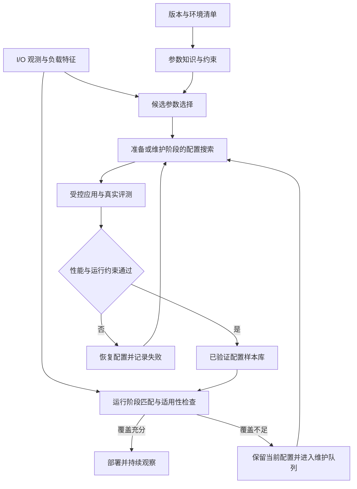

# 自动调优方法与文件系统适配指南

[English](README.md) | **简体中文**

从数据库参数调优到生产文件系统：整理 **GPTuner、E2ETune、TopTune、Rabbit、λ-Tune、AgentTune、ADSTS、STELLAR 和 ReTune**，介绍各自的核心机制，以及如何接入文件系统的参数选择、配置探索和配置推荐流程。

> **阅读说明**：原方法介绍依据论文、作者代码库或用户提供的对比表；标为“适配建议”的内容是本文提出的工程方案，不代表原论文已实现。本文没有开展这些方法的文件系统对比实验。
>
> 资料核对日期：2026-11-03。论文实验设置与代码库当前能力可能不同，复现时应固定论文版本、代码提交和模型版本。

## 导航

- [方法总览](#overview)
- [数据库调优方法](#database-methods)
- [存储与文件系统调优方法](#storage-methods)
- [文件系统适配的五个模块](#adaptation)
- [实验与比较口径](#evaluation)
- [原始对比表与术语](ORIGINAL_COMPARISON.zh-CN.md)

## 方法总览

| 方法 | 主要机制 | 文件系统适配重点 | 资料入口 |
| :--- | :--- | :--- | :--- |
| **GPTuner** | 文档知识提取、参数与范围筛选、粗到细 BO | 替换知识库和评测执行器 | [论文](https://arxiv.org/abs/2311.03157) · [代码](https://github.com/SolidLao/GPTuner) |
| **E2ETune** | 离线生成训练数据，微调模型直接输出配置 | 重建 I/O 特征、训练样本和性能代理模型 | [论文](https://www.vldb.org/pvldb/vol18/p5540-huang.pdf) · [代码](https://github.com/RUCKBReasoning/E2ETune) |
| **TopTune** | 类别与连续参数分空间协同优化 | 重建混合搜索空间、约束和评测成本 | [论文](https://ieeexplore.ieee.org/abstract/document/11113200/) |
| **Rabbit** | 原表：RAG 辅助选参，LLM 探索，GP 与实测评估 | 建立版本化参数知识和历史调优记录 | [论文入口](https://doi.org/10.1109/ICDE65448.2025.00284) |
| **λ-Tune** | 生成完整候选配置，控制候选评估成本 | 将 SQL 上下文替换为 I/O 上下文与配置计划 | [论文](https://arxiv.org/abs/2411.03500) · [代码](https://github.com/gsvic/lambda-tune) |
| **AgentTune** | 工作负载分析、选参、范围裁剪、配置推荐四个 Agent | 替换各 Agent 的领域输入和系统工具 | [代码及论文入口](https://github.com/intlyy/AgentTune) |
| **ADSTS** | 原表：LASSO 选参、RL 探索、实测反馈 | 定义文件系统状态、动作和奖励 | [论文入口](https://doi.org/10.1145/3545008.3545012) |
| **STELLAR** | 参数提取、I/O 分析、Agent 实测闭环与规则积累 | 从 Lustre 扩展到目标文件系统及其生产约束 | [论文](https://arxiv.org/abs/2602.23220) · [代码归档](https://zenodo.org/records/15284241) |
| **ReTune** | 双 LLM 选参、Agent/CEM 探索、已验证样本匹配 | 完成准备、运行、维护三阶段的系统接入 | 本项目：依据提供的对比表与项目设计稿 |

Rabbit、ADSTS 的机制介绍暂以原表为依据，本次未取得可核对的论文全文。未列代码的条目表示本次未确认作者官方仓库，不表示没有公开实现。STELLAR 提供的是作者代码归档。

### 如何理解原表中的部署与安全性

- **LLM 部署方式**：区分模型是否开放权重、实际推理是否本地运行，以及原论文实验使用的服务。开放权重模型也可以通过外部 API 调用。
- **克隆环境（CE）**：区分“需要真实反馈”“使用独立测试集群”和“必须克隆生产环境”。三者不能直接画等号。
- **压力测试（ST）**：可以为候选配置提供性能证据，但不能单独证明生产安全，还要检查尾延迟、失败、恢复和持久性语义。
- **High / Medium / Low**：保留在[原始附表](ORIGINAL_COMPARISON.zh-CN.md)，作为原稿的定性判断。它们不构成统一实验条件下的排名。

## 数据库调优方法

### GPTuner：从文档知识缩小搜索空间

**原方法。** GPTuner 收集并结构化调优知识，用于筛选重要参数、收缩取值范围，再通过粗到细的贝叶斯优化搜索配置。对应 VLDB 2024 工作。[论文](https://arxiv.org/abs/2311.03157) · [作者代码](https://github.com/SolidLao/GPTuner)

**文件系统适配建议：**

| 环节 | 需要替换或补充的内容 |
| :--- | :--- |
| 参数选择 | 用目标版本的文件系统文档、参数定义及运维记录构建知识库；提取参数类型、单位、作用域、依赖关系和生效方式。 |
| 配置探索 | 保留 BO 框架，将数据库评测器替换为 I/O 回放与文件系统指标采集；每次试验记录配置应用、稳定等待、测量及恢复时间。 |
| 配置推荐 | 输出候选配置及其证据；仅将已完成验证的候选写入可复用配置库。 |

**适用位置。** 更适合准备或维护阶段的搜索。对于数值跨度大的缓存、队列和并发参数，可先用文档限定有效域，再交给优化器；仍需为真实评测预留预算。

### E2ETune：学习工作负载到配置的映射

**原方法。** E2ETune 构建工作负载与配置训练对，微调生成式语言模型，为新负载直接推荐配置。性能代价模型用于加速离线标签生成；在线推荐的主体是微调后的模型。正式发表版本为 PVLDB 2025，不能仅凭 `huang2024e2etune` 这一引用键判断年份。[论文，§1、§4–5](https://www.vldb.org/pvldb/vol18/p5540-huang.pdf) · [作者代码](https://github.com/RUCKBReasoning/E2ETune)

**文件系统适配建议：**

| 环节 | 需要替换或补充的内容 |
| :--- | :--- |
| 负载表示 | 用读写比例、请求尺寸分布、顺序性、并发度、元数据操作比例及同步写语义替换 SQL 特征；加入硬件、拓扑与软件版本。 |
| 离线训练 | 构建文件系统的“环境—负载—候选配置—实测表现”数据；重新训练性能代理模型，并用真实测量校准标签。 |
| 在线推荐 | 将模型输出解析为受约束的配置对象；检查适用环境、资源预算和负载覆盖程度，不满足条件时保留当前配置。 |

**适用位置。** 有较多历史测量、工作负载重复性较强的场景。迁移的主要成本在数据和模型重建；数据库模型不能直接沿用到文件系统。快速推理也不意味着离线数据生成没有成本。

### TopTune：分别优化类别参数和连续参数

**原方法。** TopTune 将参数空间分为类别与连续子空间，分别使用 SMAC 和 GP 模型，并通过交替搜索与信息交互处理跨空间依赖；还使用降维与批量 BO。对应 ICDE 2025 工作。[论文摘要](https://ieeexplore.ieee.org/abstract/document/11113200/)

**文件系统适配建议：**

| 环节 | 需要替换或补充的内容 |
| :--- | :--- |
| 空间构建 | 分离策略开关、模式等类别参数，以及缓存容量、并发上限等数值参数；为整数、对齐要求和条件参数建立合法域。 |
| 协同搜索 | 保留两个子空间之间的反馈；将资源上限、参数依赖和配置切换成本纳入候选过滤与预算。 |
| 候选评测 | 只有具备资源隔离和可比状态时才并行评测；共享 OSD、MDS、网络或磁盘上的试验可能互相污染。 |

**适用位置。** 类别与数值参数存在明显交互、且维护阶段允许多次测量的场景。适配时应保留其分空间协同搜索机制，不能将其简化成普通 BO 后仍视为完整复现。

### Rabbit：把检索知识用于调优

**原表描述。** Rabbit 使用 LLM+RAG 进行参数选择，LLM 生成候选，并结合 GP 与压力测试评估。论文题为 *Rabbit: Retrieval-Augmented Generation Enables Better Automatic Database Knob Tuning*，对应 ICDE 2025。[论文入口](https://doi.org/10.1109/ICDE65448.2025.00284)

> 本次未取得论文全文。上述流水线沿用用户原表；GP 的具体角色、检索结构和 CE 要求仍待原文核验。

**文件系统适配建议：**

| 环节 | 需要替换或补充的内容 |
| :--- | :--- |
| 检索资料 | 建立版本化的参数文档与历史调优记录；每条记录包含硬件、客户端类型、负载、配置作用域和实测结果。 |
| 候选生成 | 检索时先过滤版本、资源和生效条件，再比较负载相似性；为候选保留来源和适用前提。 |
| 性能反馈 | 如果采用 GP 预测器，应使用目标文件系统样本重新训练，并通过真实回放检查候选排序与预测误差。 |

**适用位置。** 已积累运维知识和调优历史的系统。迁移时最关键的是保证检索结果在目标环境中仍然适用；语义相似不能代替性能验证。

### λ-Tune：生成完整配置并控制评估成本

**原方法。** λ-Tune 将调优上下文组织为输入，生成多个完整配置，并通过带成本控制的评估流程选择候选。它还优化输入上下文以控制提示词成本。对应 SIGMOD 2025 工作；当前仓库支持包括 Ollama 在内的多种模型服务，因此原表的“API”应视为原实验设置概括。[论文](https://arxiv.org/abs/2411.03500) · [当前作者代码](https://github.com/gsvic/lambda-tune)

**文件系统适配建议：**

| 环节 | 需要替换或补充的内容 |
| :--- | :--- |
| 上下文构建 | 将 SQL、表和索引信息替换为 I/O 摘要、文件与目录分布、客户端并发、硬件拓扑和目标指标。 |
| 配置输出 | 生成结构化配置计划，包含参数、目标对象、变更前值、生效方式及恢复步骤；由受控适配器执行。 |
| 多候选评估 | 为每个候选分配预算，将应用、重启、稳定等待和测量纳入计时；低成本初筛后仍需验证稳态表现。 |

**适用位置。** 希望先取得少量完整候选、再在有限窗口内选择的场景。短时性能差可能来自预热或后台积压，应避免将尚未稳定的候选过早淘汰。

### AgentTune：按职责拆分调优过程

**原方法。** 作者仓库将流程拆分为 Workload Analyzer、Knob Selector、Range Pruner 和 Configuration Recommender 四个 Agent，并提供更换数据库时替换连接、参数和工作负载处理逻辑的说明。仓库当前标注 SIGMOD 2026，标题与用户原引用存在版本差异；正式引用时应核对最终出版记录。[作者代码与迁移说明](https://github.com/intlyy/AgentTune)

**文件系统适配建议：**

| Agent | 文件系统职责 |
| :--- | :--- |
| Workload Analyzer | 汇总客户端 I/O、元数据操作、节点负载与瓶颈指标，输出可比较的负载摘要。 |
| Knob Selector | 依据文件系统文档与瓶颈证据选择候选参数，明确客户端、元数据和数据路径的作用域。 |
| Range Pruner | 约束内存、并发、取值依赖和可变更窗口；拒绝不兼容的参数组合。 |
| Configuration Recommender | 使用结构化工具执行候选评估；为搜索分支记录有效配置、性能反馈和恢复状态。 |

**适用位置。** 工作流复杂、希望分别替换或评估各阶段的场景。将多个 Agent 接入同一集群时，还需要配置锁和状态版本检查，防止一次试验覆盖另一次试验的配置。

## 存储与文件系统调优方法

### ADSTS：基于反馈学习配置策略

**原表描述。** ADSTS 使用 LASSO 与实测筛选参数，采用强化学习探索配置，再以实测反馈评估。论文题为 *ADSTS: Automatic Distributed Storage Tuning System Using Deep Reinforcement Learning*，对应 ICPP 2022。[论文入口](https://doi.org/10.1145/3545008.3545012)

> 本次未取得论文全文。此处仅沿用用户原表的算法分类，不将具体训练开销、性能数字或 CE 要求视为已核验结论。

**文件系统适配建议：**

| 环节 | 需要替换或补充的内容 |
| :--- | :--- |
| 参数筛选 | 在可控窗口内采样合法配置，通过重复测量建立参数与性能关系；固定非目标变量，降低噪声对 LASSO 筛选的干扰。 |
| RL 状态与动作 | 状态包含负载、缓存、队列、后台任务和当前配置；动作为满足约束的参数调整，而非任意全量配置写入。 |
| 奖励与运行 | 在吞吐收益之外显式约束尾延迟、错误、资源占用和变更成本；区分训练期探索与训练后策略推理。 |

**适用位置。** 有足够交互预算、负载模式可重复的场景。它面向分布式存储，适配重点是目标接口和观测语义；对于 CephFS，应检查观测与奖励是否覆盖 MDS、客户端缓存及元数据路径。

### STELLAR：面向并行文件系统的 Agent 调优闭环

**原方法。** STELLAR 从文档提取参数，分析应用 I/O，执行配置调整与应用重跑，并将经验整理为可复用规则。其公开论文在 CloudLab 的 Lustre 环境中评估；论文还说明生产规模与权限方面的限制。它已面向文件系统，适配工作主要是跨系统迁移和生产接入。[论文，§4–5](https://arxiv.org/html/2602.23220v1) · [作者代码归档](https://zenodo.org/records/15284241)

**文件系统适配建议：**

| 环节 | 需要替换或补充的内容 |
| :--- | :--- |
| 参数与工具 | 迁移到 CephFS 等系统时重建文档索引、配置命令与指标映射；Lustre 参数和规则不能按名称直接迁移。 |
| 工作负载分析 | 保留 I/O 特征分析，补充目标系统的元数据、缓存和后台恢复状态；检查监测开销。 |
| 生产执行 | 将可重复应用重跑放入维护窗口，建立可回退的变更计划，并把规则绑定到版本与环境条件。 |

**适用位置。** 有代表性应用、允许重复运行且具备配置权限的 HPC 场景。公开实验使用测试集群，不足以单独证明“算法必须克隆生产环境”；规则积累也不意味着后续配置可以无条件跳过验证。

### ReTune：将搜索验证与在线推荐分开

**本项目设计。** 按用户提供的表格与项目设计稿，ReTune 通过本地双 LLM 进行参数筛选与交叉核验，由 Agent 调用数值搜索工具，在准备或维护阶段建立已验证样本；运行阶段依据负载相似性推荐配置。此处的 `Workload sim.` 指 **workload similarity（工作负载相似度）**，并非仿真器。

**文件系统适配建议：**

| 阶段 | 需要实现的内容 |
| :--- | :--- |
| 准备阶段 | 建立目标版本的参数知识、受控配置接口和工作负载表征；生成并验证初始样本。 |
| 运行阶段 | 先按版本、硬件和配置适用条件过滤样本，再匹配负载；通过覆盖阈值后才提出配置变更。 |
| 维护阶段 | 对未覆盖负载进行预算内搜索和实测，将通过验证的配置加入样本库，更新失效记录。 |

**适用边界。** 样本覆盖不足时应保留现有配置并登记待处理负载。相似度需要通过目标环境的退化风险校准，不能将“相似”直接视为“安全”。不克隆生产环境仍需为准备、维护和验证承担资源成本。

## 文件系统适配的五个模块

以下是面向上述方法的统一适配建议，便于共享基础设施，同时保留各方法的核心算法。

### 模块一：参数知识与执行适配器

先把“参数值”转换为“有明确作用域和生效条件的配置项”。建议为每个参数保存以下字段：

| 字段 | 用途 |
| :--- | :--- |
| `name`, `type`, `unit`, `domain` | 统一名称、数据类型、单位与合法取值。 |
| `system_version`, `source` | 绑定软件版本与依据，避免跨版本误用。 |
| `scope`, `target` | 明确客户端、目录、MDS、OSD、主机或集群等目标。 |
| `dependencies`, `resource_constraints` | 表达参数关系和共享资源上限。 |
| `apply_mode`, `settle_condition` | 记录在线生效、重启、重挂载等方式，以及何时允许测量。 |
| `previous_value`, `previous_source`, `rollback_plan` | 保存原值及其来源，明确恢复操作与验证方式。 |

以 Ceph 为例，中央配置数据库、配置文件及运行时覆盖可能共同影响最终值；适配器应核对目标进程的有效配置。参数说明必须匹配实际部署版本。[Ceph 官方配置文档](https://docs.ceph.com/en/reef/rados/configuration/ceph-conf/)

建议提供 `describe_parameters`、`read_effective_config`、`validate_config`、`apply_config`、`wait_until_stable`、`collect_metrics`、`restore_config` 等结构化接口。接入 AS13000 等系统时，应映射到相应版本实际提供的管理与监控接口。

### 模块二：工作负载表征与回放

数据库查询特征需要转换为文件系统可观测、可复现的 I/O 行为。建议分开保存**需求特征**与**运行反馈**，避免把当前配置造成的瓶颈误当成工作负载本身。

| 类别 | 建议记录的信息 |
| :--- | :--- |
| 数据访问 | 读写比例、请求尺寸分布、顺序性、偏移分布、热点与工作集。 |
| 文件和元数据 | 文件尺寸分布、目录结构、create/open/stat/rename/unlink 等操作比例。 |
| 并行与共享 | 客户端数、进程/线程数、请求队列深度、共享文件及锁竞争。 |
| 持久性语义 | buffered/direct I/O、fsync 频率、完成确认条件。 |
| 系统反馈 | 客户端和服务端延迟、缓存命中、资源占用、后台任务与错误。 |

可按目标选择数据 I/O、元数据及应用级回放器。对所有方法固定数据集、客户端布局和缓存协议。若生产系统不能清缓存，应将缓存状态作为测量条件记录，而不能把热缓存收益归因于配置优化。

### 模块三：搜索与候选评估

保留各方法核心机制，将文件系统差异放在统一适配层。下表是迁移时的接口划分建议。

| 方法族 | 应保留的核心机制 | 应替换的领域组件 |
| :--- | :--- | :--- |
| GPTuner / Rabbit | 知识驱动的候选生成与各自搜索流程 | 参数文档、检索记录、负载与反馈接口。 |
| E2ETune | 离线训练到直接推荐的映射 | 训练数据、负载编码、代理模型与输出约束。 |
| TopTune | 类别与数值子空间协同搜索 | 参数域、条件依赖及试验调度器。 |
| λ-Tune / AgentTune | 多候选评估或 Agent 搜索流程 | 调优上下文、配置执行器与性能工具。 |
| ADSTS | 基于反馈的策略学习 | 状态、动作、奖励及环境复位。 |
| STELLAR | I/O 分析、工具执行与规则积累 | 目标文件系统工具及规则适用条件。 |
| ReTune | 阶段分离与已验证样本匹配 | 后端适配器、特征、样本覆盖和维护流程。 |

搜索预算应覆盖配置应用、稳定等待、测量及恢复，而不仅是优化器计算时间。若用代理模型替代真实评测，应单独标记为新增变体，并报告排序误差、误选率和真实验证成本。

### 模块四：推荐、部署与恢复

建议将推荐结果表示为：**目标配置 + 适用条件 + 验证证据 + 变更步骤 + 恢复步骤**。

1. 检查软件版本、硬件、资源余量和候选适用条件。
2. 检查当前配置是否与生成计划时一致，保存实际有效值及来源。
3. 对允许变更的目标应用配置，核对生效状态并等待稳定。
4. 同时观察目标性能、尾延迟、后台积压和错误情况。
5. 触发退化条件时恢复原配置，再验证有效值和服务状态。

配置恢复不一定立即撤销缓存、数据布局或后台队列的变化。含重启、迁移或持久化布局影响的参数，应单独定义恢复条件和维护要求，不能统一视为即时可逆动作。

### 模块五：本地模型与知识维护

本地部署需要覆盖推理、检索、日志和模型调用工具链。替换外部 API 后，应重新评估参数选择质量、结构化输出有效率、工具调用成功率和推理时间。

知识与样本建议按“文件系统版本—硬件与拓扑—负载—配置—实测结果”保存。升级版本、改变设备或客户端布局后，先检查样本兼容性，再决定复用、重测或失效；低覆盖负载进入维护队列。

## 实验与比较口径

### 统一条件

比较完整系统时，应给各方法相同的合法参数全集、硬件、负载、可靠性约束和总时间预算，再允许其执行自己的选参流程。仅比较搜索器时，才固定相同的筛选后参数集。两类实验应分别报告。

固定数据集、客户端布局、实际 I/O 量、队列深度、缓存状态和后台任务条件。对训练或检索方法按工作负载或时间切分样本，防止测试负载及其最佳配置进入训练集或样本库。

### 建议报告的指标

| 维度 | 指标 |
| :--- | :--- |
| 参数选择 | 有效参数比例、证据可追溯率、选择时间；有独立标注时报告准确性。 |
| 配置探索 | 最佳已验证性能随墙钟时间的变化、实测次数、失败试验数、资源消耗。 |
| 推荐与上线 | 推荐时延、部署与稳定时间、覆盖率、拒绝率、退化率和恢复时间。 |
| I/O 性能 | 带宽、IOPS、元数据操作率、P95/P99 延迟，以及应用端到端表现。 |
| 资源与语义 | 实际物理读写量、CPU、内存、网络、后台积压；保持相同持久性要求。 |
| 总成本 | 离线数据采集与训练、维护搜索、模型推理和线上变更的分项成本。 |

至少分开报告三类时间：**在线调整时间**（请求到配置部署并达到预定义稳定条件）、**维护调优时间**（搜索、回放与补样本）、**端到端时间**（从任务产生到最终配置稳定）。单次推荐快，不能替代完整调优成本的比较。

### 结果表述

适配实现尚未测量时，应使用“拟适配”“适配建议”或“待验证”。公开结果应写明具体环境和预算，不从“采用 BO / RL / LLM”直接推导精度等级，也不从“经过压力测试”直接推导生产安全。
