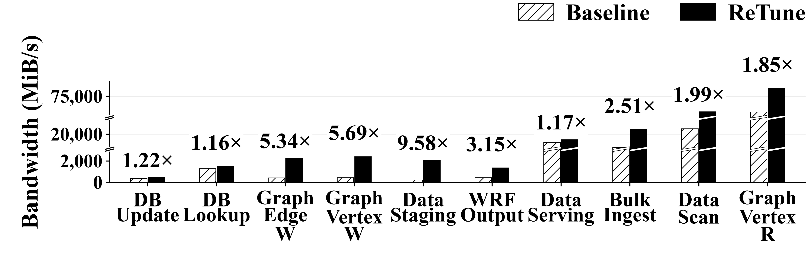
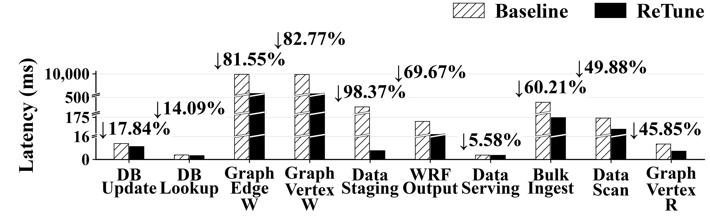

# ReTune Results at the Guangzhou Supercomputing Center

**English** | [简体中文](README.zh-CN.md) · [Back to the guide](../../README.md#guangzhou-results)

These figures show file-system I/O tuning observations from **128 physical storage nodes at the Guangzhou supercomputing center**. They compare ReTune-labeled historical tuning results against the registered baseline for ten typical workloads. They do not compare ReTune against the database or file-system tuning methods listed in the survey.

## Deployment and measurements

| Item | Recorded setting |
| :--- | :--- |
| Physical deployment | 128 physical storage nodes; confirmed by the project owner on 2026-11-03. |
| Storage software | Ceph 17.2.7, CephFS; 128 OSDs, 16 active MDS daemons, and 2 standbys. |
| Clients | Up to 16 FUSE clients; standard random/sequential I/O uses 8 clients, mixed/graph/HPC I/O uses 16, and the plotted fio case uses 1 client and 1 stream. |
| HPC output | IOR-based `wrfout` I/O with 64 MPI ranks; the tuned run executes `wrfout` without checkpointing. |
| Replication | The experimental pool uses a single replica; results do not establish performance at other replication factors. |

The physical-node count and the OSD count describe different deployment quantities. Software and workload settings follow the archived experiment report. The plots show ten improvement cases drawn from 22 comparable subcases. For each subcase, the ReTune bar is the completed tuning observation with the highest recorded bandwidth; its latency is taken from the same observation. Configurations can differ across subcases.

## Bandwidth

*Bandwidth of typical workloads on 128 physical storage nodes at the Guangzhou supercomputing center. Higher is better; annotations show ReTune / baseline.*

[Vector SVG](figures/retune_bandwidth.svg) · [PDF](figures/retune_bandwidth.pdf)

## Latency

*Latency of the same typical workloads. Lower is better; annotations show the percentage reduction relative to the baseline.*

[Vector SVG](figures/retune_latency.svg) · [PDF](figures/retune_latency.pdf)

White hatched bars denote Baseline; solid black bars denote ReTune. Diagonal cuts mark omitted axis ranges. Bandwidth is in MiB/s and latency is in ms. Latency is mean I/O latency except for the IOR case, which reports rank-0 write/fsync time amortized per segment. The figures do not report P95 or P99 latency.

## Workload labels and measured operations

The labels describe application-inspired I/O patterns. In particular, **DB Update and DB Lookup are file-system I/O tests, not DBMS knob-tuning or transaction-throughput results**.

| Figure label | Measured workload |
| :--- | :--- |
| DB Update | 4 KiB random write. |
| DB Lookup | 4 KiB random read. |
| Graph Edge W | Graph edge sequential write. |
| Graph Vertex W | Graph vertex sequential write. |
| Data Staging | fio single-stream read capped at 2 GiB/s. |
| WRF Output | IOR `wrfout` output I/O; excludes WRF computation and checkpointing in the tuned run. |
| Data Serving | 128 KiB mixed I/O with 90% reads to 400 KiB files. |
| Bulk Ingest | 4 MiB sequential write. |
| Data Scan | 4 MiB sequential read. |
| Graph Vertex R | Graph vertex random read; the archived run retains OSD backend caching. |

## Reading the results

- Graph vertex writes reach **5.69×** baseline bandwidth with **82.77%** lower latency; graph edge writes reach **5.34×** with **81.55%** lower latency.
- IOR `wrfout` reaches **3.15×** baseline bandwidth with **69.67%** lower amortized latency. This measures output I/O, not complete WRF application speedup.
- The fio **9.58×** observation approaches the configured 2 GiB/s cap. The baseline and tuned records differ in preceding workflow and FUSE implementation, so this is not a strictly paired, repeated system-speedup result.
- These are historical best-observed improvement cases, not an average over the complete suite. Independent-run variability is not summarized. Configuration and client-implementation changes are not isolated, so these plots do not establish a causal contribution from dual LLMs, CEM, or similarity matching.

## Data and verification

- [Exact plotting data](data/plot_data.json): native metric strings, including operation-rate data that are not plotted here. The HPC operation rate is IOR's native `Mean(OPs)` and should not be treated as interchangeable with data IOPS.
- [Values and annotations used by the figures](data/used_values.csv): 40 plotted values and their derived labels.
- [Recomputed summary](data/summary.csv): baseline/tuned bandwidth and latency, bandwidth factors, and latency reductions for all ten workloads.
- [Provenance and SHA-256 hashes](data/provenance.json): source locations within the plotting kit, deployment provenance, asset hashes, and audit counts.

Bandwidth factor is `ReTune / baseline`. Latency reduction is `100 × (1 − ReTune / baseline)`. Both use unrounded input values. On 2026-11-03, all 60 native metrics were rechecked against 41 archived source files, including the 40 values plotted here. The largest native-to-summary difference was `5E-14`, below display precision. Raw operational logs are not included in this repository.
