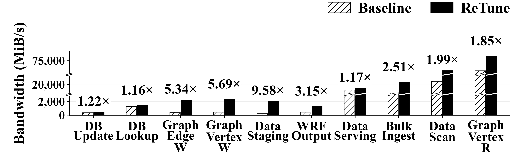
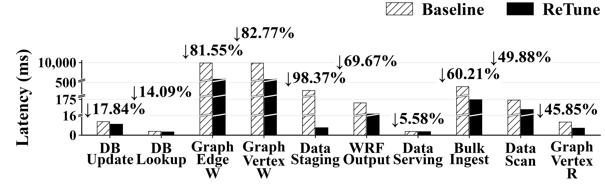

# ReTune 广州超算中心调优结果

[English](README.md) | **简体中文** · [返回展示首页](../../README.zh-CN.md#guangzhou-results)

以下图表展示 **广州超算中心 128 个物理存储节点**上的文件系统 I/O 调优观察，对比十个典型负载的 ReTune 历史调优结果与登记基线。它们不是 ReTune 与综述中数据库或文件系统调优方法的横向对比实验。

## 部署与测量

| 项目 | 记录配置 |
| :--- | :--- |
| 物理部署 | 128 个物理存储节点；项目负责人于 2026-11-03 确认。 |
| 存储软件 | Ceph 17.2.7、CephFS；128 OSD、16 个活跃 MDS 和 2 个 standby。 |
| 客户端 | 最多 16 个 FUSE 客户端；标准随机/顺序 I/O 使用 8 客户端，混合/图/HPC I/O 使用 16 客户端，图中 fio 项使用 1 客户端、1 流。 |
| HPC 输出 | 基于 IOR 的 `wrfout` I/O，使用 64 个 MPI rank；调优运行仅执行 `wrfout`，不包含检查点。 |
| 副本数 | 实验池为单副本；结果不能直接代表其他副本数的性能。 |

物理节点数与 OSD 数是两种不同的部署指标。软件及负载设置依据归档实验报告。图中展示从 22 个可比较子项中选出的十个改善案例；各子项的 ReTune 柱对应已完成调优中带宽最高的历史观察，时延也取自该次观察。不同子项可以使用不同配置。

## 带宽

*广州超算中心 128 个物理存储节点上典型负载的带宽。越高越好，标注为 ReTune / 基线。*

[矢量 SVG](figures/retune_bandwidth.svg) · [PDF](figures/retune_bandwidth.pdf)

## 时延

*相同典型负载的时延。越低越好，标注为相对基线的时延下降百分比。*

[矢量 SVG](figures/retune_latency.svg) · [PDF](figures/retune_latency.pdf)

白底斜线柱表示 Baseline，黑色实心柱表示 ReTune；斜线断口表示省略的坐标区间。带宽单位为 MiB/s，时延单位为 ms。除 IOR 项使用按 segment 摊销的 rank-0 写入/fsync 时间外，其余为平均 I/O 时延。图中没有报告 P95 或 P99 时延。

## 图中标签与实际测量对象

标签表示应用场景对应的 I/O 模式。其中，**DB Update 和 DB Lookup 是文件系统 I/O 测试，不是 DBMS 参数调优或数据库事务吞吐结果**。

| 图中标签 | 实际测量负载 |
| :--- | :--- |
| DB Update | 4 KiB 随机写。 |
| DB Lookup | 4 KiB 随机读。 |
| Graph Edge W | 图边数据顺序写。 |
| Graph Vertex W | 图顶点数据顺序写。 |
| Data Staging | fio 单流读取，限速 2 GiB/s。 |
| WRF Output | IOR `wrfout` 输出 I/O；不包含 WRF 计算，调优运行也不包含检查点。 |
| Data Serving | 对 400 KiB 文件执行 128 KiB 混合 I/O，读占 90%。 |
| Bulk Ingest | 4 MiB 顺序写。 |
| Data Scan | 4 MiB 顺序读。 |
| Graph Vertex R | 图顶点随机读；归档运行保留 OSD 后端缓存。 |

## 结果解读

- 图顶点写带宽达到基线的 **5.69×**，时延下降 **82.77%**；图边写达到 **5.34×**，时延下降 **81.55%**。
- IOR `wrfout` 带宽达到基线的 **3.15×**，摊销时延下降 **69.67%**。这里测量的是输出 I/O，不是完整 WRF 应用加速。
- fio 的 **9.58×** 观察接近设定的 2 GiB/s 限速。基线与调优记录的前序流程及 FUSE 实现不同，因此不是严格配对、重复验证的系统加速结果。
- 这些是历史最佳观察中的改善案例，不是完整测试集的平均收益，且尚未汇总独立重复运行的方差。配置和客户端实现的变化未被单独隔离，不能由这些图推导双 LLM、CEM 或相似度匹配各自的因果贡献。

## 数据与核验

- [精确绘图数据](data/plot_data.json)：保留原生指标字符串，也包含本次未绘制的操作率数据。HPC 操作率为 IOR 原生 `Mean(OPs)`，不能与数据 IOPS 混用。
- [图中使用的数值与标注](data/used_values.csv)：40 个绘图数值及对应的派生标注。
- [重新计算的汇总](data/summary.csv)：十个负载的基线/调优带宽与时延、带宽倍数和时延下降比例。
- [来源与 SHA-256 校验值](data/provenance.json)：绘图包内的来源位置、部署信息来源、图表哈希和核验计数。

带宽倍数为 `ReTune / 基线`，时延下降比例为 `100 × (1 − ReTune / 基线)`，均使用未舍入值计算。2026-11-03 已对照 41 个归档来源文件重新核验全部 60 个原生指标，其中包括本次绘制的 40 个数值。原生值与汇总值的最大差为 `5E-14`，低于显示精度。仓库不包含原始运维日志。
